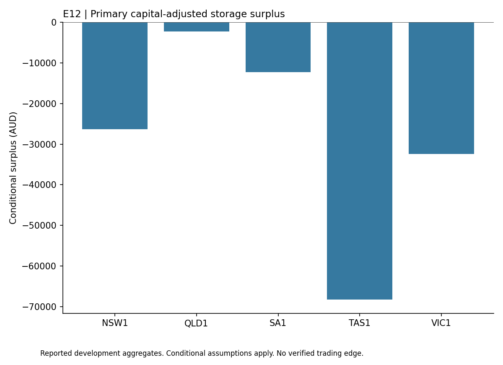

# NEM Battery Arbitrage

## Findings

This study evaluated a fixed daily storage schedule in Australia's National Electricity Market during January to June 2023. It was a conditional physical asset benchmark, not an assertion that an investor could trade regional prices without owning and operating an eligible asset.

The five region reference portfolio generated approximately AUD 200,455 of operating cash. The assumed capital recovery charge was approximately AUD 341,931, leaving a capital adjusted surplus of -AUD 141,476. Every regional primary result was negative. The fixed development criterion failed, and July to September 2023 remains sealed.

These results depend on assumed equipment, efficiency, operating costs and capital treatment. They do not establish site eligibility, actual connection and market charges or executable asset revenue. Positive operating cash alone would have omitted the largest cost in this model.

## Reading this report

This public copy contains the findings of one completed development study. Its chart uses only the small aggregate table in [findings.json](findings.json). The original research history, raw observations, source datasets and reserved confirmation periods remain private. This copy does not reproduce a historical backtest or establish an independently confirmed strategy.

Install matplotlib in your own Python environment, then run `python plot_results.py` to regenerate the chart. The script reads the saved table and makes no network requests. These are reported findings from the original study, not a fresh evaluation. Passing an integrity check or reproducing this chart does not validate profitability.

The [public file manifest](PUBLIC_FILES.json) records hashes of the report, aggregate table, chart script and figure. This copy was prepared without the original Git history so personal commit email addresses are not exposed. It grants no rights to underlying third-party datasets.
